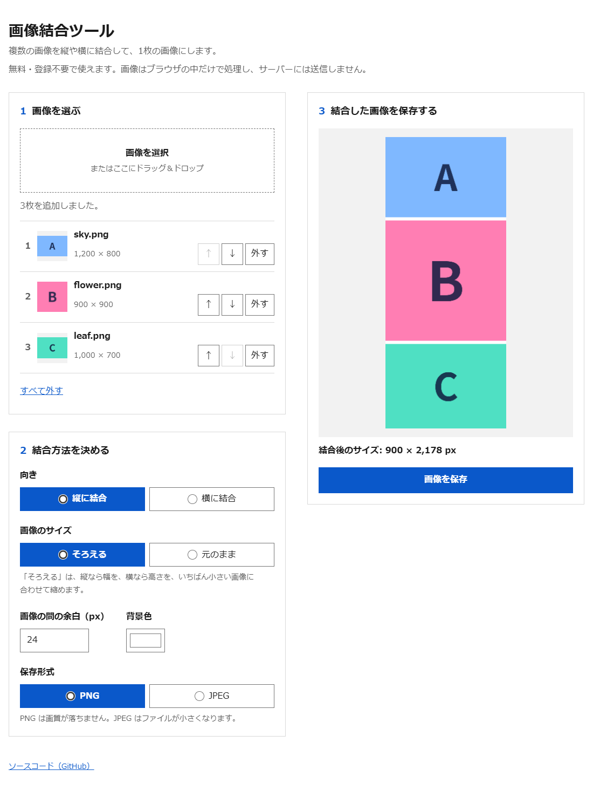

# 画像結合ツール

複数の画像を縦や横に結合して、1枚の画像にするWebアプリです。ブラウザで開いて使います。



## 機能
- 画像を選択するか、ドラッグ＆ドロップで追加する
- 画像の順番を入れ替える
- 縦か横に結合する。画像のサイズは、いちばん小さい画像に合わせてそろえるか、元のままにする
- 画像の間の余白と、背景色を決める
- プレビューで確かめて、PNGかJPEGで保存する

## 使い方
https://syugo1142.github.io/image-joiner/ を開きます。

- 画像はブラウザの中だけで処理し、サーバーには送信しません
- 結合方法の設定（向き・余白など）は、ブラウザのlocalStorageに保存します。画像は保存しません
- 結合した画像は、縦・横それぞれ32,767pxまで、面積は16,384 × 16,384pxまで作れます。スマートフォンでは、端末によってこれより小さいサイズまでしか作れないことがあります

## 使用技術
- フロントエンド: TypeScript、[Vite](https://vite.dev/)、Canvas API（画像の描画）、node:test（配置の計算のテスト）
- インフラ・CI/CD: GitHub Pages（ホスティング）、GitHub Actions（型チェック・テスト・デプロイ）

## 開発
Node.js 24 以降が必要です。
```
npm ci            # 必要な部品（Vite、TypeScript）を入れる
npm run dev       # 開発用サーバーを起動する（http://localhost:5173/）
npm run build     # デプロイするファイルを dist/ に作る
npm run preview   # 作った dist/ を手元で開く（http://localhost:4173/）
npm run typecheck # 型の間違いがないか確かめる
npm test          # 配置の計算と設定の読み込みを自動でテストする（test/）
```
main に push すると、GitHub Actions が型チェックとテストを行い、ビルドして GitHub Pages にデプロイします。
